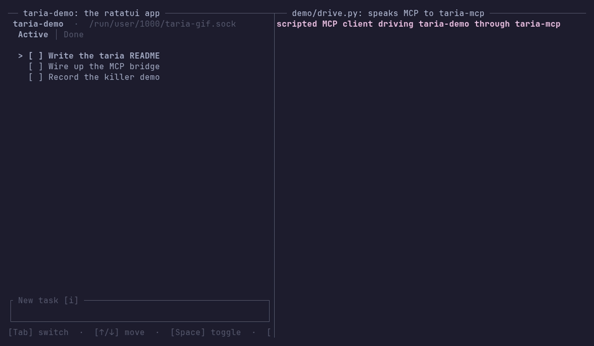

# taria

[](https://github.com/y0sif/taria/actions/workflows/ci.yml)
[](https://crates.io/crates/taria-ratatui)
[](https://crates.io/crates/taria-mcp)
[](https://docs.rs/taria-ratatui)

**ARIA for terminals.** taria is an agent accessibility layer for terminal
user interfaces. A TUI app declares its live widget tree, focus state, and
available actions through a small protocol. An MCP bridge exposes that tree
to any agent harness (Claude Code, OpenCode, Cursor): the harness drives the
app through ordinary MCP tools, with no taria-specific code of its own.



The client on the right is a script, `demo/drive.py`, not a model: it makes
six fixed tool calls through the real `taria-mcp` bridge.

Agents today reach TUIs by scraping rendered screens through tmux or headless
terminals and guessing at structure. taria works on the other side of the
terminal: the app publishes what is on screen semantically, the way
accessibility trees transformed GUI automation.

> Status: alpha, at 0.4.0. The wire format is frozen at `PROTOCOL_VERSION` 1,
> so an app and a bridge built months apart still work together. The Rust
> API may still change in a 0.x minor release, and each such change gets an
> upgrade note in [CHANGELOG.md](CHANGELOG.md). CI tests Linux, macOS and
> Windows.

## Why taria

- **The app answers, not the screen.** An agent names a widget by the id
  your app gave it, not by where it sits on screen, and picks one of the
  actions the app offers for it right now. The app says what it did with
  each input: took it, ignored it, or dropped it because its queue was full.
  When the input changed something, the agent gets the new tree with the
  answer.
- **Partial coverage still works.** Describe three widgets and stop. An
  agent reaches the rest with raw key presses and typed text, which your app
  takes through its own input handling, as it takes a person's.
- **Safe to ship.** Each app gets its own socket, or a named pipe on
  Windows, that only your user can open. The message format between app and
  bridge is frozen and only grows, so their versions can differ. The library
  returns errors instead of panicking, and if it cannot start, your app runs
  as before.

In a benchmark on 2026-10-12, against the 0.3.0 demo, Claude Haiku 5.5
passed 30 of 30 runs reading taria's JSON tree, with a median of 14,045
tokens read and 3 tool calls per run, and 29 of 30 reading the screen
through tmux, with 26,722 tokens and 6.5 tool calls. On Sonnet 5.5 the two
were close: tmux used 7.7% fewer tokens than taria's JSON tree, and 1.7%
more than its outline format. Method and caveats:
[bench/RESULTS.md](bench/RESULTS.md).

## In your app

A ratatui app publishes nodes after it draws and takes agent input in its
event loop, beside its terminal events:

```rust
use taria_ratatui::taria::{Action, Node, Role};
use taria_ratatui::{InputStatus, TariaLayer};

// Never fails: if taria cannot bind, the layer does nothing.
let mut layer = TariaLayer::bind_or_disabled("my-app");
loop {
    terminal.draw(|frame| view(&app, frame))?;
    // Say what is on screen, after every draw.
    layer.publish([Node::new("save", Role::Button)
        .label("Save")
        .action(Action::Activate)]);
    wait_for_event(&mut app)?; // your event handling, unchanged
    layer.drain(|input| {
        app.apply(input); // as if a person had done it
        InputStatus::Delivered // or Ignored, if it did nothing
    });
}
```

[docs/integration-guide.md](docs/integration-guide.md) walks through adding
taria to an app you already have, including the loop's timing rules.

## Install

Two sides, two different things to install.

**Writing a TUI app that agents should be able to use.** One dependency:

```bash
cargo add taria-ratatui
```

It re-exports the protocol crate, so `taria::{Action, IdSpace, Node, Role}`
is reachable as `taria_ratatui::taria::{...}` without a second dependency.
`docs/integration-guide.md` walks through the retrofit.

**Driving an app that already speaks taria.** Install the bridge binary:

```bash
cargo install taria-mcp
```

Or take a prebuilt build from the
[releases page](https://github.com/y0sif/taria/releases): a tag builds
`taria-mcp` as a tarball for x86_64 and aarch64 Linux and for both macOS
architectures, and as a `.zip` for x86_64 Windows
(`taria-mcp-x86_64-pc-windows-msvc.zip`, holding `taria-mcp.exe`), each with
its sha256. Then point your harness at it, with the app's label:

```bash
claude mcp add taria -- taria-mcp --app <label>
```

On Windows both sides work the same way, from the same commands: the app and
the bridge meet over a named pipe (Windows' local IPC channel) instead of a
Unix socket, and neither needs a `cfg` or a flag of its own. Put
`taria-mcp.exe` somewhere on your `PATH`, or give the harness its full path.

The quick start below uses the demo app in this repository instead, which
needs nothing installed.

## Quick start

Prerequisites: a Rust toolchain (1.88 or newer) and, for step 2, the
`claude` CLI. Three steps, two terminals.

1. Run the demo app in one terminal. It prints its taria socket path on
   startup and then behaves like a normal task-manager TUI:

   ```bash
   cargo run -p taria-demo
   ```

2. Register the bridge with your agent harness. Build it first, then for
   Claude Code:

   ```bash
   cargo build -p taria-mcp
   claude mcp add taria -- $(pwd)/target/debug/taria-mcp --app taria-demo
   ```

   Working inside this repo, you can skip `claude mcp add`: the committed
   `.mcp.json` registers the same server, and Claude Code picks it up here
   once you approve it.

3. Ask the agent to drive the app: "read the tree, add a task called ship
   v0, mark it done, then delete it". The agent works through the
   `read_tree`, `act`, `type_text`, and `key` tools while the TUI reacts in
   the first terminal.

### Running the demo headless

Backgrounding the demo with plain `&` fails. Give it a terminal with tmux
instead:

```bash
cargo build -p taria-demo
tmux new-session -d -s taria-demo -x 120 -y 34 './target/debug/taria-demo'
tmux capture-pane -p -t taria-demo   # peek at the screen without attaching
tmux kill-session -t taria-demo      # stop it when you are done
```

## How it works

The app publishes a semantic snapshot of its widget tree over a Unix domain
socket, or a named pipe on Windows, one JSON object per line (ndjson), on
every meaningful change. The bridge holds the latest snapshot and exposes it,
plus input back into the app, as MCP tools. Agent input reaches the app's
event loop like any other input source, and the app acknowledges each input by
id, so the bridge can tell an input the app acted on from one it never saw.
The bridge connects on its first tool call and lets the app go after 60 s with
no tool calls by default, so an idle agent session does not keep the app from
another.

```text
+---------------+   Unix socket  +-----------+  MCP over stdio  +---------------+
|    TUI app    | <------------> | taria-mcp | <--------------> | agent harness |
| taria-ratatui |  or Windows    |  bridge   |                  | (Claude Code) |
|               |  named pipe    |           |                  |               |
|               |    (ndjson)    |           |                  |               |
+---------------+                +-----------+                  +---------------+
```

What an app can say about a widget is a fixed vocabulary: 29 roles (`list`,
`tree`, `table`, `text_input`, `select`, `dialog`, `log`, `chart`,
`scrollbar`, `terminal` and the rest) and 7 actions (`activate`, `focus`,
`select`, `toggle`, `scroll`, `set_value`, `dismiss`), plus a custom action
for anything an app names itself. Both vocabularies are open: a peer that
meets a role or an action it does not know degrades that one field instead of
failing the tree, which is what lets either grow inside a frozen format. A
node can also carry typed state: whether it is selected, checked, expanded
or disabled, a number and its bounds, and where it sits in a list or a
table.

## MCP tools

| Tool | What it does |
|---|---|
| `read_tree` | Returns the app's current semantic tree as JSON: node ids, roles, labels, values, focus, typed state such as selected, checked or disabled, the actions each node advertises, and a `relayed` mark on any node whose text came from outside the app, which the agent reads as data. The app's own snapshot minus its `type` key and its input stamp, every other field kept, so a role or field this bridge has never heard of arrives under its real name. With `--tree-format outline`, the same snapshot comes as one indented line per node instead, which for the demo's first tree is about half the characters. |
| `act` | Invokes an advertised action on a node by id, with an optional value (e.g. for `set_value`), up to 4096 characters. The node id and the action are checked against the latest tree before anything is sent, and an act on a node marked disabled is refused. |
| `key` | Sends a raw key press (`"q"`, `"enter"`, `"ctrl+c"`), up to 64 times with `repeat`. A key that does not match the grammar is rejected here rather than swallowed by the app. A fallback for parts of the UI without semantic coverage. |
| `type_text` | Types a literal string in one call instead of one `key` call per character, up to 4096 characters. It goes where the app puts typing, never through the app's key bindings, so move the keyboard to the target first: act on its advertised `focus` action, or on `set_value`, which many apps focus as a side effect. An app accepting no typing reports it ignored rather than acting on the characters. |

The three input tools wait for the app's answer and report what actually
happened: the updated tree, an input the app deliberately ignored (with the
current tree to re-plan from), an input the app acknowledged and did not
survive (an advertised `quit`, working), or an error for an input that was
dropped, never applied, or left unaccounted for by an app that went away
before acknowledging it. A taria-ratatui 0.4.0 app stamps each tree with the
newest input it took, so the answer is the tree published after that input:
up to 3 s for a slow handler, and "did not change" within a frame for an
input that changed nothing. Against an app that does not stamp, the wait is
500 ms, as before.

## taria-mcp CLI

The bridge takes exactly one of `--socket <path>` or `--app <label>`. With
`--app`, it resolves the socket path the same way the app-side adapter does
when binding. `--tree-format outline` serves the tree as an indented outline
instead of JSON. `--idle-release <SECS>` sets how long the bridge waits with
no tool calls before it lets the app go: 60 by default, `0` for never. The
flags, the environment variables, the resolution order, the rule on labels
and the outline's grammar: [docs/cli.md](docs/cli.md).

## Workspace layout

```text
crates/taria          Core protocol types (widget tree, actions, snapshots)
crates/taria-ratatui  Ratatui adapter: publish semantics alongside rendering
crates/taria-mcp      MCP bridge binary for agent harnesses
examples/demo-app     Demo ratatui app driven by an agent through taria
scripts/              Python verification harnesses (e2e, adversarial)
docs/                 Protocol spec, architecture, integration guide,
                      comparison, landscape research
bench/                Benchmark harness and results: taria against tmux
demo/                 The GIF above and the scripted client that records it
```

In `docs/`: `protocol.md` specifies the wire format message by message,
`architecture.md` explains why it is shaped that way, and `landscape.md` is
the research behind both.

## Development

```bash
cargo check --workspace
cargo test --workspace
cargo clippy --all-targets -- -D warnings
cargo fmt --check
python3 scripts/e2e.py           # end-to-end: 27 steps, demo app + bridge + MCP
python3 scripts/adversarial.py   # 24 edge-case probes
```

[CONTRIBUTING.md](CONTRIBUTING.md) covers the rest: the setup, the CI gate,
the commit style, and what a change has to clear while version 1 of the wire
format is frozen.

## Compatibility

See [docs/compatibility.md](docs/compatibility.md) for the full list. The
three that decide whether taria fits at all:

- **Linux, macOS and Windows**: a Unix socket on the first two, a named pipe
  on Windows, and CI runs the Rust suites on all three. Windows has no
  stopped-app detection, and the Python e2e and adversarial scripts run on
  Linux and macOS only. [Limitations](docs/compatibility.md#limitations).
- **One bridge client per app at a time**: the adapter serves one, so two
  agents cannot drive the same app at once. They can take turns: an idle
  bridge lets the app go after 60 s by default.
  [Limitations](docs/compatibility.md#limitations).
- **The wire format is frozen at `PROTOCOL_VERSION` 1**: changes within
  version 1 are additive, so a version difference costs a degraded field
  rather than the whole tree.
  [What the freeze promises](docs/compatibility.md#compatibility).

---

## [How taria compares](docs/comparison.md)

## [FAQ](docs/faq.md)

---

## License

Dual-licensed under MIT or Apache-2.0, at your option.

## MCP registry

The [MCP registry](https://registry.modelcontextprotocol.io/) reads the line
below to check that the `taria-mcp` crate belongs to this server.

mcp-name: io.github.y0sif/taria-mcp
