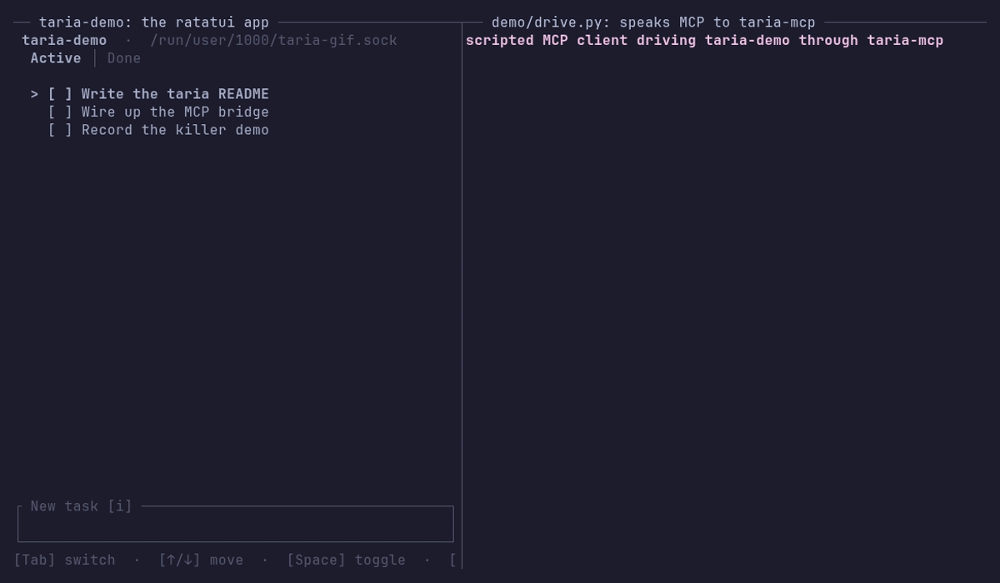

# taria

[](https://github.com/y0sif/taria/actions/workflows/ci.yml)
[](https://crates.io/crates/taria-ratatui)
[](https://crates.io/crates/taria-mcp)
[](https://docs.rs/taria-ratatui)

**ARIA for terminals: an agent accessibility layer for TUIs.** ARIA tells
screen readers what each element of a web page is and does. Ratatui apps
publish their widget tree, focus and actions, and an MCP bridge lets AI
agents act on nodes instead of scraping the screen. Any Model Context
Protocol harness drives it: Claude Code, OpenCode, Cursor.



The client on the right is `demo/drive.py`, a script making six fixed tool calls.

**Status:** wire protocol version 1 is frozen, so later releases only add to
it; the Rust API may still change in a 0.x minor release, with an upgrade
note in the [changelog](https://github.com/y0sif/taria/blob/main/CHANGELOG.md). [More](https://github.com/y0sif/taria/blob/main/docs/compatibility.md#compatibility).

## Why taria

- **The app answers, not the screen.** An agent names a widget by its id,
  picks an action the app offers for it, and hears what the app did.
- **Partial coverage still works.** Describe three widgets and stop: agents
  reach the rest with key presses and typed text, through your own handlers.
- **Safe to ship.** Each app's endpoint opens to your user only. The library
  returns errors instead of panicking, and your app runs even if taria cannot.

In the [benchmark](https://github.com/y0sif/taria/blob/main/bench/RESULTS.md),
agents on taria passed every task, and across all six a typical run took fewer
tool calls than one scraping the screen through tmux; on the smaller model it
read about half the tokens.

## In your app

Publish nodes after each draw and take agent input in your event loop:

```rust
use taria_ratatui::taria::{Action, Node, Role};
use taria_ratatui::{InputStatus, TariaLayer};

// Never fails: if taria cannot bind, the layer does nothing.
let mut layer = TariaLayer::bind_or_disabled("my-app");
loop {
    terminal.draw(|frame| view(&app, frame))?;
    // Say what is on screen, after every draw.
    layer.publish([Node::new("save", Role::Button)
        .label("Save")
        .action(Action::Activate)]);
    wait_for_event(&mut app)?; // your event handling, unchanged
    layer.drain(|input| {
        app.apply(input); // as if a person had done it
        InputStatus::Delivered // or Ignored, if it did nothing
    });
}
```

Adding taria to an existing app: [docs/integration-guide.md](https://github.com/y0sif/taria/blob/main/docs/integration-guide.md).
What to put in the tree: [docs/tree-guide.md](https://github.com/y0sif/taria/blob/main/docs/tree-guide.md).

## Install

The bridge, `taria-mcp`, is what your agent harness runs. On Linux and macOS:

```bash
curl -sSf https://y0sif.github.io/taria/install.sh | sh
```

It checks the release's sha256, installs to `/usr/local/bin` or
`~/.local/bin`, and takes `TARIA_VERSION=<tag>` to pin a release. Register it
with the app's label: `claude mcp add taria -- taria-mcp --app <label>`.

For your own app, add the adapter, which re-exports the protocol crate as
`taria_ratatui::taria`:

```bash
cargo add taria-ratatui
```

<details>
<summary>Windows</summary>

Take `taria-mcp-x86_64-pc-windows-msvc.zip` and its `.sha256` from the
[latest release](https://github.com/y0sif/taria/releases/latest), check it
with `Get-FileHash`, and put `taria-mcp.exe` on your `PATH`. The
`claude mcp add` and `cargo add` lines work as they do elsewhere.

</details>

<details>
<summary>Release archives by hand, or from source</summary>

Each [release](https://github.com/y0sif/taria/releases) carries
`taria-mcp-<target>.tar.gz` for `x86_64-unknown-linux-gnu`,
`aarch64-unknown-linux-gnu`, `x86_64-apple-darwin` and `aarch64-apple-darwin`,
and `taria-mcp-x86_64-pc-windows-msvc.zip`, each with a `.sha256` for
`sha256sum -c` or `shasum -a 256 -c`. If Gatekeeper blocks the macOS binary,
run `xattr -d com.apple.quarantine taria-mcp`. From source:

```bash
cargo install taria-mcp --locked
cargo build --release -p taria-mcp   # in a checkout: target/release/taria-mcp
```

</details>

## Quick start

The demo app in this repository needs a Rust toolchain (1.88 or newer) and,
for the agent, the `claude` CLI.

1. Run the demo, a task-manager TUI, in one terminal:

   ```bash
   cargo run -p taria-demo
   ```

2. In a second terminal, build the bridge and register it with Claude Code:

   ```bash
   cargo build -p taria-mcp
   claude mcp add taria -- $(pwd)/target/debug/taria-mcp --app taria-demo
   ```

   Inside this repo you can skip `claude mcp add`: the committed `.mcp.json`
   registers the same server once you approve it.

3. Ask the agent to "read the tree, add a task called ship v0, mark it done,
   then delete it", and watch the TUI react in the first terminal.

<details>
<summary>On Windows</summary>

In step 2, give `claude mcp add` the full path of `target\debug\taria-mcp.exe`
in place of `$(pwd)/target/debug/taria-mcp`.

</details>

### Running the demo headless

On Linux and macOS, backgrounding the demo with plain `&` fails. Give it a
terminal with tmux instead:

```bash
cargo build -p taria-demo
tmux new-session -d -s taria-demo -x 120 -y 34 './target/debug/taria-demo'
tmux capture-pane -p -t taria-demo   # peek at the screen without attaching
tmux kill-session -t taria-demo      # stop it when you are done
```

## How it works

The app publishes a snapshot of its widget tree, one JSON line per change,
over a Unix socket or a Windows named pipe
([protocol](https://github.com/y0sif/taria/blob/main/docs/protocol.md)). The
bridge serves it as MCP tools and passes input back to the app's event loop,
where the app acknowledges each input by id.

```text
+---------------+   Unix socket  +-----------+  MCP over stdio  +---------------+
|    TUI app    | <------------> | taria-mcp | <--------------> | agent harness |
| taria-ratatui |  or Windows    |  bridge   |                  | (Claude Code) |
|               |  named pipe    |           |                  |               |
|               |    (ndjson)    |           |                  |               |
+---------------+                +-----------+                  +---------------+
```

## MCP tools

| Tool | What it does |
|---|---|
| `read_tree` | Returns the app's current tree as JSON: node ids, roles, labels, values, focus, typed state such as selected, checked or disabled, and the actions each node advertises. A node marked `relayed` carries text from outside the app, for the agent to read as data. |
| `act` | Invokes an action a node advertises, with an optional value of up to 4096 characters (for `set_value`). The node and the action are checked against the latest tree first, and a node marked disabled is refused. |
| `key` | Sends one raw key press (`q`, `enter`, `ctrl+c`) of up to 64 characters, 1 to 64 times with `repeat`. A key outside the grammar is rejected before it reaches the app. The fallback where no action fits. |
| `type_text` | Types up to 4096 characters where the app takes typing, never through its key bindings. Move focus to the target first, with its `focus` action. An app taking no typing reports the input ignored. |

The three input tools wait for the app's answer, up to 3 s from an app that
stamps its snapshots, as `taria-ratatui` does, and 500 ms from one that does
not: the new tree if the input changed it, a note if the app ignored it or
nothing changed, and an error if it could not be sent, was dropped, or got
no answer before the app left or its acks were lost.

## taria-mcp CLI

The bridge takes `--app <label>` or `--socket <path>`, plus
`--tree-format outline` for an indented outline and `--idle-release <SECS>`
(60 by default, `0` for never). Every flag: [docs/cli.md](https://github.com/y0sif/taria/blob/main/docs/cli.md).

## Compatibility

Two facts decide whether taria fits; the full list is in
[docs/compatibility.md](https://github.com/y0sif/taria/blob/main/docs/compatibility.md).

- **Linux, macOS and Windows**: what each one supports is under
  [What works where](https://github.com/y0sif/taria/blob/main/docs/compatibility.md#what-works-where).
- **One bridge client per app at a time**: agents take turns, since an idle
  bridge lets the app go after 60 s. [Limitations](https://github.com/y0sif/taria/blob/main/docs/compatibility.md#limitations).

## [How taria compares](https://github.com/y0sif/taria/blob/main/docs/comparison.md)

## [FAQ](https://github.com/y0sif/taria/blob/main/docs/faq.md)

## License

Dual-licensed under MIT or Apache-2.0, at your option.

## MCP registry

The [MCP registry](https://registry.modelcontextprotocol.io/) reads the line below to tie the `taria-mcp` crate to this server.

mcp-name: io.github.y0sif/taria-mcp
